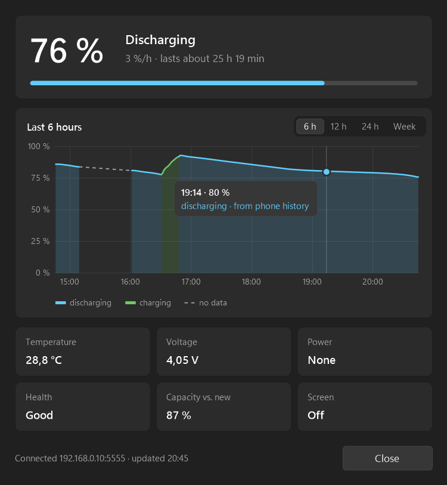

# Phone battery tray

Shows your Android phone's battery level in the Windows system tray, over
adb by Wi-Fi. Made for a phone used as a webcam on calls: it sits with the
camera facing you, and you cannot see its screen.



## What it does

- **Tray icon**: a phone outline in the Windows 11 icon style, filled to
  the charge level. Red at 30 % and below when not charging, a lightning
  bolt while charging, a grey "?" when the phone is not reachable. Updated
  once a minute.
- **Hover** the icon for level, state, temperature, screen on/off and the
  time of the last reading.
- **Double-click** (or "Wake phone" in the menu) turns the phone screen on
  and dismisses the lock screen, so the camera app gets a picture again.
- **Notifications**: battery at 30 % or lower, charger disconnected, phone
  not responding three times in a row.
- **Details window** (right-click → Details…): level, charging or discharging
  rate with time to full or to empty, voltage, battery health, screen state
  and a chart of the charge for 6 h, 12 h, 24 h or a week. Hover the line to
  see the time and level of any reading. On Samsung phones it also shows the
  remaining capacity compared to a new battery.
- **No gaps while the PC sleeps**: after a gap the program fetches the
  phone's own battery history (`dumpsys batterystats`) and fills the chart
  from it. Only where there is no data at all (the phone was off, or it
  wiped its history while charging before the PC woke up) the chart shows a
  dashed line.
- Light and dark theme follow Windows. The interface is in Russian on a
  Russian Windows and in English otherwise.

Windows 10 or 11. A single exe of about 50 KB, nothing to install.

## Setup

1. **Get adb.** Download
   [Android SDK Platform-Tools](https://developer.android.com/tools/releases/platform-tools)
   and unpack it. The program looks for `adb.exe` next to itself, in a
   `platform-tools` folder next to it or one level up, in the Android SDK
   (`%LOCALAPPDATA%\Android\Sdk\platform-tools`), and finally in `PATH`.
   The simplest layout:

   ```
   tools\
     platform-tools\adb.exe
     phone-battery-tray\phone-battery.exe
   ```

2. **Turn on USB debugging on the phone.** Settings → About phone →
   Software information → tap "Build number" seven times. Then Settings →
   Developer options → USB debugging.
3. **Get the program.** Download `phone-battery.exe` from
   [Releases](../../releases), or build it yourself (see below).
4. **Run it and connect the phone by USB** with a data cable once. When the
   phone asks "Allow USB debugging?", tick "Always allow from this computer"
   and tap Allow. Within a minute the program switches adb to Wi-Fi
   (port 5555) and remembers the phone's address. After that the cable can
   be unplugged. The phone and the PC must be on the same network.

**After the phone reboots**, adb over Wi-Fi is off again, and the icon turns
into a grey "?". Plug in the cable for a minute and the program switches it
back on by itself.

## Start with Windows

Task Scheduler is more reliable than the Startup folder, which Windows
processes with a delay of up to several minutes. Create a task:

- Trigger: *At log on* of your user.
- Action: *Start a program*, `phone-battery.exe`.
- Conditions: clear *Start the task only if the computer is on AC power*.
- Settings: clear *Stop the task if it runs longer than 3 days*.

A second copy will not start. To exit: right-click the icon → Exit. If you
cannot see the icon, it may be hidden under the "^" arrow in the tray; drag
it onto the taskbar.

## Files next to the exe

| File | What |
|---|---|
| `history.csv` | One line per reading: `time;level;1 if charging`. About 40 KB a day, trimmed to 30 days |
| `phone-history.csv` | The phone's own history, per minute, in the same format. Used only to fill gaps |
| `phone-ip.txt` | The phone's Wi-Fi address, written when the phone is connected by USB |

All of them can be deleted; history then starts again. Whole-file rewrites
go through a temporary file and a swap, so a power loss mid-write keeps the
old version.

## Build

The C# compiler that ships with .NET Framework 4 in Windows is enough. Close
the running program first, then in PowerShell, in this folder:

```
C:\Windows\Microsoft.NET\Framework64\v4.0.30319\csc.exe /nologo /codepage:65001 /target:winexe /optimize /out:phone-battery.exe /r:System.Windows.Forms.dll /r:System.Drawing.dll phone-battery.cs
```

That compiler only knows C# 5: no `$"..."` strings, no `?.`.

Pictures for checking without the tray:

- `phone-battery.exe --preview icons.png` draws the icon in every state;
- `phone-battery.exe --details window.png [history.csv]` draws the Details
  window with sample values, for every period;
- `phone-battery.exe --chart chart.png [history.csv]` draws the 24-hour
  chart.

Set `PHONE_BATTERY_LANG=en` or `ru` to force the interface language.

## How it works

Every minute the program runs `dumpsys battery` and `dumpsys power` over
adb. After a gap longer than 5 minutes it also reads
`dumpsys batterystats --history`: the phone logs an event at least every
30 seconds with the battery level, as offsets from a `TIME:` mark. A pause
over 10 minutes or a `SHUTDOWN`/`START` event means the phone was off, and
that stretch is not filled.

## License

MIT, see [LICENSE](LICENSE).
